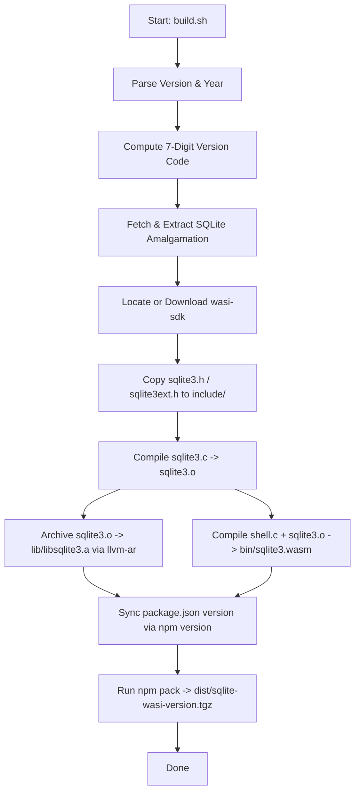

# Project Specification: sqlite-wasi

## 1. Executive Summary

`sqlite-wasi` is a distribution project designed to compile, package, and release the official SQLite database engine and its command-line interface (CLI) for the **WASI Preview 1** (`wasm32-wasip1`) environment. 

The project packages both low-level native artifacts (static C library and headers for downstream WebAssembly compilation) and high-level runnable artifacts (WASI CLI binary and a zero-dependency Node.js runner) into a unified npm tarball (`sqlite-wasi-<version>.tgz`) distributed publicly via GitHub Releases.

---

## 2. Goals and Non-Goals

### 2.1 Goals
- **WASI Preview 1 Compatibility**: Produce standards-compliant WebAssembly binaries targeting `wasm32-wasi` that run on any compliant runtime (e.g., `wasmtime`, `wasmer`, `wazero`, Node.js `node:wasi`).
- **Complete C Toolchain Assets**: Deliver `libsqlite3.a` and C headers (`sqlite3.h`, `sqlite3ext.h`) to allow other C/C++ projects targeting WASI to link SQLite directly.
- **Standalone CLI Binary**: Deliver `sqlite3.wasm` compiled from `shell.c`.
- **Zero-Dependency Quick Execution**: Include a Node.js runner (`bin/cli.js`) allowing users to run `npx sqlite-wasi` with local filesystem access without third-party npm dependencies.
- **Reproducible & Configurable Builds**: Parameterize SQLite version and release year in build scripts and GitHub Actions.
- **Manual Release Pipeline**: Release assets exclusively via manual GitHub workflow dispatch.

### 2.2 Non-Goals
- **WASI Preview 2 / Component Model**: The scope is strictly WASI Preview 1 (`wasm32-wasip1`).
- **Dynamic Extension Loading**: In WASI preview 1, dynamic library loading (`dlopen`) is not supported, so SQLite extension loading is omitted.
- **Multi-threaded In-Memory Concurrency**: WASI preview 1 does not provide standard POSIX threads; SQLite is compiled in single-threaded mode (`SQLITE_THREADSAFE=0`).
- **Automatic Scheduled Releases**: Releases are strictly trigger-based via `workflow_dispatch`.

---

## 3. Architecture & Repository Layout

### 3.1 Repository Structure

```
sqlite-wasi/
├── .github/
│   └── workflows/
│       └── release.yml          # GitHub Actions workflow for manual releases
├── bin/
│   ├── cli.js                  # Node.js WASI CLI runner script
│   └── sqlite3.wasm            # (Generated) SQLite CLI WebAssembly binary
├── include/                     # (Generated) SQLite C API headers
│   ├── sqlite3.h
│   └── sqlite3ext.h
├── lib/                         # (Generated) SQLite static library
│   └── libsqlite3.a
├── scripts/
│   └── build.sh                # Core compilation and packaging script
├── dist/                        # (Generated) Output distribution archives (.tgz)
├── build/                       # (Generated) Ephemeral build cache & downloads
├── index.js                    # Programmatic JS module API
├── package.json                # npm package definition
├── Makefile                    # Local build entrypoints (build, pack, clean)
├── SPEC.md                     # Technical architecture & specification
├── README.md                   # User guide and examples
├── LICENSE                     # MIT License & SQLite Blessing notice
└── .gitignore                  # Git exclusions for build artifacts
```

### 3.2 Distributed npm Package Layout (`sqlite-wasi-<version>.tgz`)

```
package/
├── bin/
│   ├── cli.js
│   └── sqlite3.wasm
├── include/
│   ├── sqlite3.h
│   └── sqlite3ext.h
├── lib/
│   └── libsqlite3.a
├── index.js
├── package.json
├── README.md
└── LICENSE
```

---

## 4. Build System Specification

### 4.1 Toolchain Requirements
- **Compiler**: Clang from `wasi-sdk` (targeting `wasm32-wasi`).
- **Archiver**: `llvm-ar` from `wasi-sdk`.
- **Sysroot**: `wasi-sysroot` provided with `wasi-sdk`.
- **Runtime Tools**: `curl`, `tar`, `unzip`, `node` (>= 18), `npm`.
- **Default SDK Version**: `wasi-sdk` release 25.

### 4.2 SQLite Source Amalgamation
SQLite distributes code as an amalgamation archive with an encoded version:
- **Version Number**: `Major.Minor.Patch[.Subpatch]` (e.g. `3.54.1`).
- **Encoding Scheme**: `3XXYYZZ` (7-digit representation).
  - Version `3.54.1` maps to `3540100`.
- **Download URL Format**:
  ```
  https://www.sqlite.org/{RELEASE_YEAR}/sqlite-amalgamation-{ENCODED_VERSION}.zip
  ```

### 4.3 Compilation Flags & Rationale

#### Common Flags (Static Library & CLI)
| Flag | Rationale |
|---|---|
| `-O3` | Maximize execution performance for SQL query processing |
| `--target=wasm32-wasi` | Targets the WASI preview 1 ABI |
| `--sysroot=${SYSROOT}` | Links standard libc headers and stubs from wasi-sdk |
| `-DSQLITE_THREADSAFE=0` | WASI preview 1 lacks POSIX thread primitives |
| `-DSQLITE_OMIT_LOAD_EXTENSION=1` | WASI preview 1 lacks dynamic linker (`dlopen`/`dlsym`) |
| `-DSQLITE_OS_UNIX=1` | Maps SQLite OS abstraction to POSIX-compliant WASI file descriptors |
| `-DSQLITE_ENABLE_MATH_FUNCTIONS` | Enables standard mathematical SQL functions (`sin`, `cos`, `sqrt`, etc.) |

#### CLI-Specific Flags (`sqlite3.wasm`)
| Flag / Linker Option | Rationale |
|---|---|
| `-DSQLITE_NOHAVE_SYSTEM` | WASI preview 1 cannot spawn child processes with `system()` |
| `-D_WASI_EMULATED_SIGNAL` / `-lwasi-emulated-signal` | Emulates signal APIs for shell interrupt handling |
| `-D_WASI_EMULATED_PROCESS_CLOCKS` / `-lwasi-emulated-process-clocks` | Emulates process timers (`getrusage`) using wall clock |
| `-D_WASI_EMULATED_GETPID` / `-lwasi-emulated-getpid` | Emulates `getpid()` placeholder |
| `src/wasi_compat.c` | POSIX stub for `gethostname()` returning `-1` with `ENOSYS` |

### 4.4 Build Pipeline Stages



---

## 5. Runtime & Integration Specification

### 5.1 Node.js Runner (`bin/cli.js`)
- **Engine**: Node.js built-in `node:wasi` API (`version: 'preview1'`).
- **Filesystem Virtualization**:
  - Automatically mounts the working directory:
    ```js
    preopens: {
      '.': process.cwd()
    }
    ```
- **CLI Arguments**: Standard `process.argv.slice(2)` passed as `argv[1..n]` with `sqlite3` as `argv[0]`.
- **Process Exit**: Captures exit code via `wasi.start(instance)` and `err.code` to preserve SQLite CLI status code.

### 5.2 Programmatic Node.js API (`index.js`)
Exposes:
- `runCLI(args, options)`: Programmatically launches the SQLite WASI CLI with configurable arguments, environment, and stream overrides.
- `wasmPath`: Full path to `bin/sqlite3.wasm`.
- `libPath`: Full path to `lib/libsqlite3.a`.
- `includePath`: Full path to `include/`.

### 5.3 Standalone WASI Engines
The compiled `bin/sqlite3.wasm` operates as a standard WASI command module.
- **Wasmtime**:
  ```bash
  wasmtime --dir=. bin/sqlite3.wasm [database-file] [sql]
  ```
- **Wasmer**:
  ```bash
  wasmer run --dir=. bin/sqlite3.wasm -- [database-file] [sql]
  ```

### 5.4 C/Wasm Toolchain Linker Specification
Downstream projects compiling C/C++ to WebAssembly with `wasi-sdk` can link directly:
```bash
clang --target=wasm32-wasi \
  --sysroot=${WASI_SDK_PATH}/share/wasi-sysroot \
  -I/path/to/package/include \
  -L/path/to/package/lib \
  main.c -lsqlite3 -o app.wasm
```

---

## 6. Release & CI/CD Specification

### 6.1 GitHub Actions Workflow (`.github/workflows/release.yml`)
- **Trigger**: `workflow_dispatch` (manual execution only).
- **Inputs**:
  - `sqlite_version`: SQLite semantic version (default: `3.54.1`).
  - `sqlite_year`: Release year corresponding to the SQLite version (default: `2026`).
- **Runner**: `ubuntu-latest`.
- **Artifact Generation**: Runs `./scripts/build.sh ${{ inputs.sqlite_version }} ${{ inputs.sqlite_year }}`.
- **Release Publishing**:
  - Tag: `v${sqlite_version}` (e.g. `v3.54.1`).
  - Asset: `dist/sqlite-wasi-${sqlite_version}.tgz`.
  - Tool: GitHub CLI (`gh release create` / `gh release upload`).
